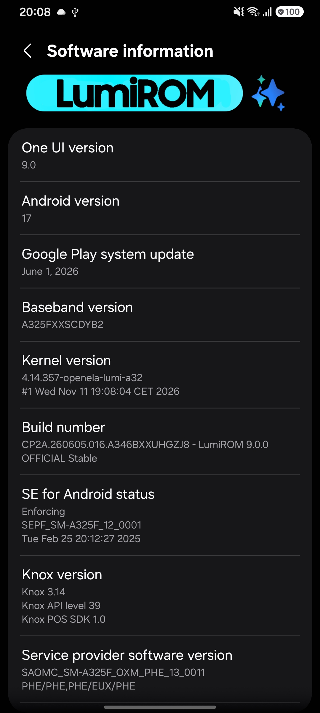
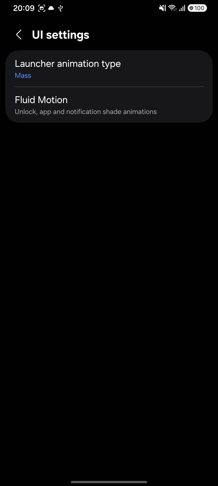
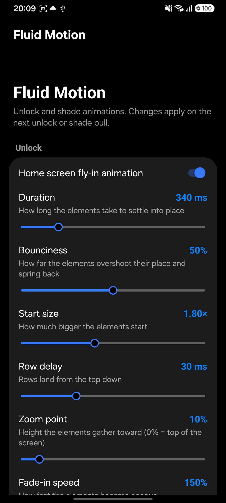

# What's changed on LumiROM 9.0.0?

> [!IMPORTANT]
> LumiROM 9.0.0 is based on a new Android/One UI release. A clean flash is recommended when coming from One UI 8.5; back up your data first.

## Features
- Upgraded the base to **One UI 9 / Android 17** (`A346BXXUHGZJ8`).
- Added **FluidMotion** animations as static ports, with no root or LSPosed required:
  - **UnlockFlyIn**: home-screen unlock fly-in animation.
  - **AppUnlock**: app unlock animation in SystemUI.
  - **ShadeFlyIn**: notification fly-in animation.
- Added the **FluidMotion settings app** to LumiROM Settings > UI Settings, where the unlock, app and shade animations can be adjusted.
- Added **Samsung debloat** for ShareLive, Rubin, SCPM and IP Service to reduce background RAM and CPU usage.

## Fixes
- Fixed video playback crashes in YouTube and local players caused by the One UI 9 `libion.so` stub (Codec2/ION). The same backport restores MediaCodec video playback in Chrome.
- Reduced Quick Settings split-panel jank by removing per-frame logging from the slide transition; QS rendering stays native.
- Fixed the SDHMS SIOP warning on One UI 9.
- Re-applied the Samsung Camera patch and the existing ROM fixes on the new base.

## More
- [Repo] New `CodecFix` mod with the One UI 8.5 `libion.so` backport so codecs doesn't die.
- [Repo] FluidMotion static ports integrated into `Mods/FluidMotion` (SystemUI and Launcher).
- [Repo] Added the new debloat entries to `DEBLOAT_APPS`.
- [Repo] FluidMotion preference controller key handling fix in the LumiSettings SecSettings overlay.
- Thanks to ProjectCipher for the apks.

# Screenshots

  

# Download
[Download LumiROM 9.0.0](https://t.me/LumiROMs)
