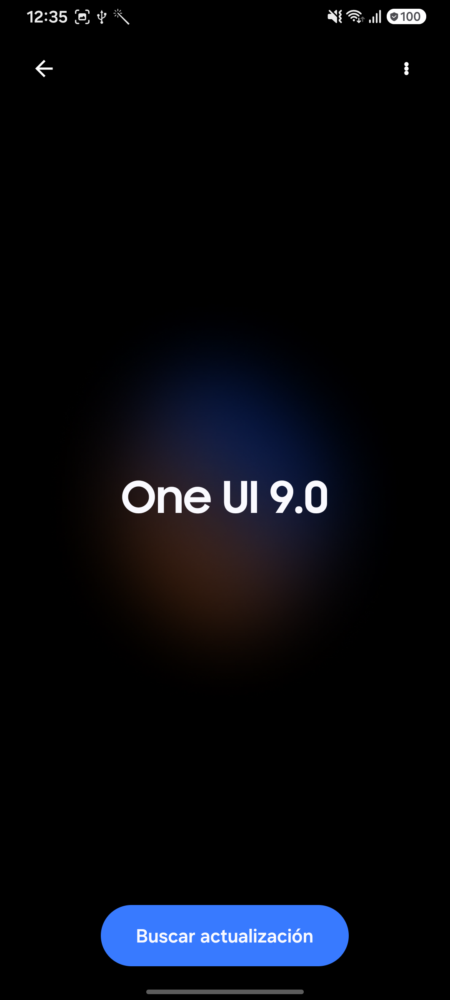
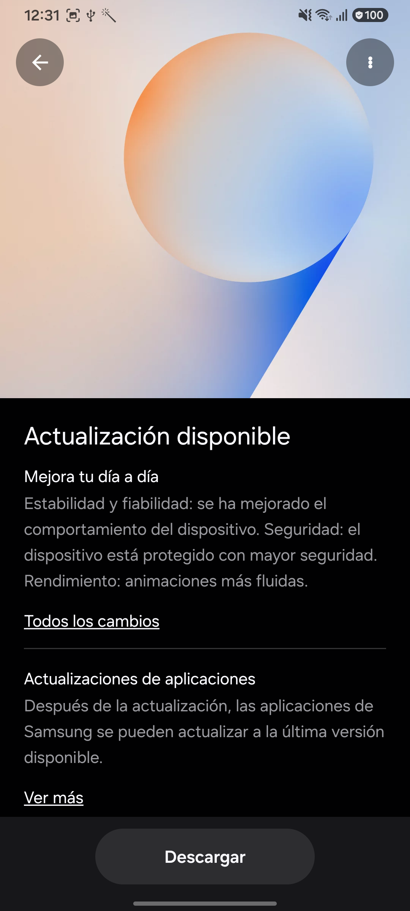
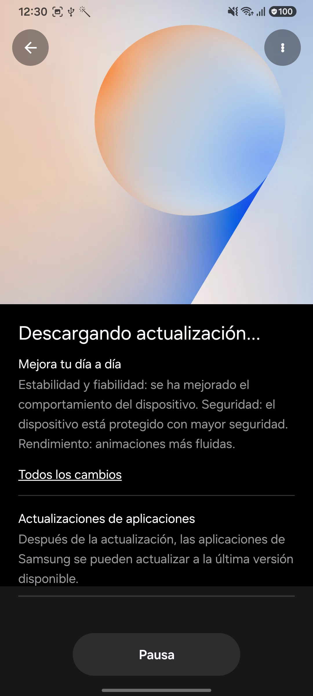
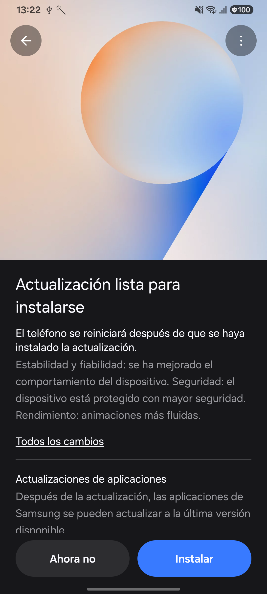
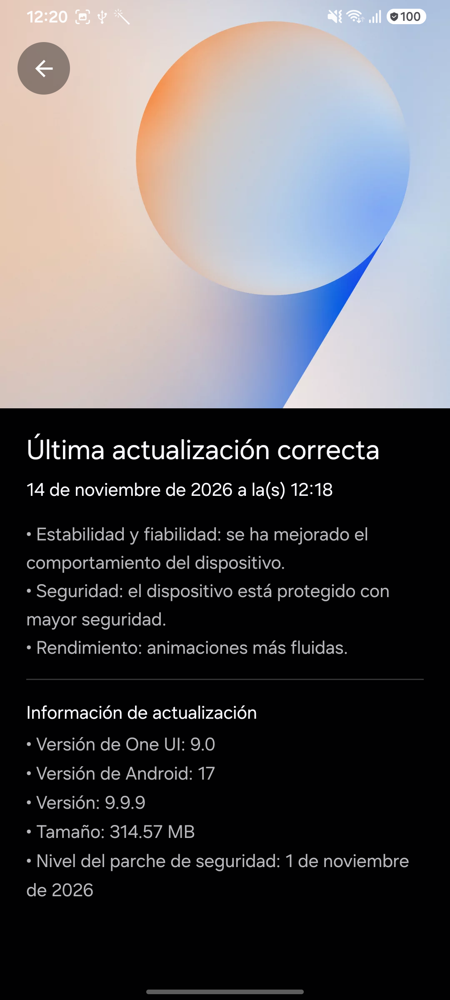
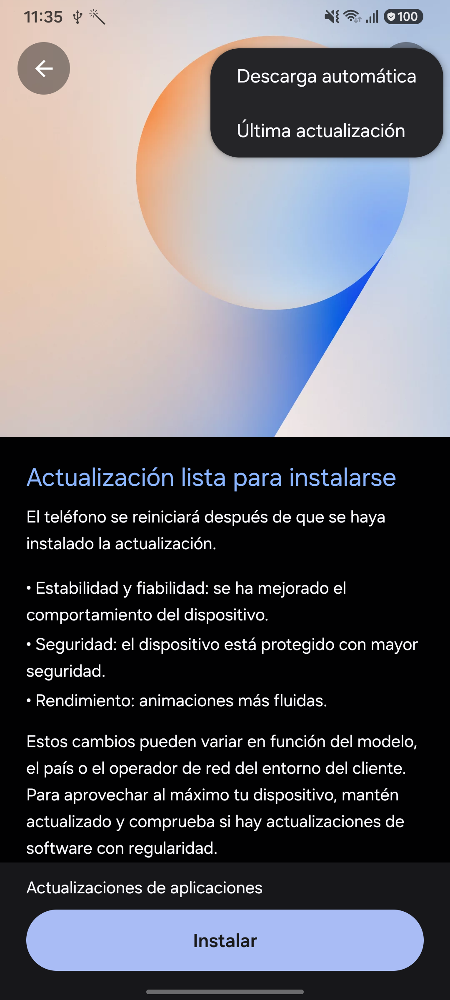
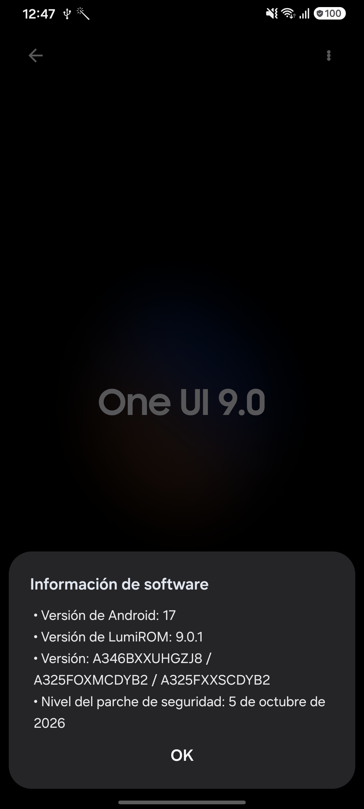

# What's changed on LumiROM 9.0.2?

> [!NOTE]
> LumiROM 9.0.2 Performance Update is a maintenance update over 9.0.1.

## Features
- **AI-free by default.** Official builds no longer include Galaxy AI. It is opt-in: use `--ai` (or set `USE_GALAXY_AI=true` in the workflow) if you want it. The stock A34 AI apps (Smart Suggestions, Photo Remaster, Call Assistant, Bixby Vision, Video Editor Lite) and their AI feature flags are removed; the Document Scanner is kept.
- **LumiFota replaces Cloudy.** Cloudy is discontinued. The new OTA client is built from scratch with the One UI 9 Software Update look and reads its manifests from `LumiROM/updater`.

## Fixes
- Fixed VPN and connection issues (second time the charm).
- Fixed the JPG issue being white or not loading at all.
- Fixed the hotspot turning-off bug: the SoftAp teardown no longer blocks, and the fix is baked into the Wi-Fi APEX without modules or root.
- Fixed the Wi-Fi APEX patch that could truncate `service-wifi.jar` and bootloop. The ext4 payload is now grown before writing the patched jar and the jar is verified after insertion.
- Fixed the brightness collapsing at maximum brightness. The ported kernel has no HBM support for the A32 panel, so when One UI switched to high-brightness mode the panel was given a ~26/255 brightness index and dropped to about 5% instead of getting brighter. HBM is now disabled, so the panel stays at its real maximum (255/255) and the auto-brightness curve behaves like stock.
- Fixed the GPU staying at 299 MHz on the A34→A32 port: the GED fallback DVFS now samples correctly and keeps a 663 MHz floor, dropping the GPU frame time from ~13-14 ms to ~5 ms and making 90 Hz animations much smoother.
- Fixed the LumiFota OTA app and the FluidMotion settings app not installing. One UI only registers system packages that are declared in `allowed-system-preload`, so both were dropped during the boot scan without any error. They are now declared, so LumiFota is installed as the privileged updater and Settings → LumiROM → UI → Fluid Motion opens its screen again.

## More
- [Repo] Kernel rebuilt for the A325F/A325M with the GED DVFS fallback fixes and the 663 MHz GPU floor.
- [Repo] `services.jar` patch that forces `HighBrightnessModeController.isHbmCurrentlyAllowed()` to `false`. The previous HBM timing, hysteresis and darkening-hold patches were dropped: `timeMaxMillis` capped HBM at five minutes and the A32 panel driver cannot do HBM at all.
- [Repo] Hotspot APEX patch: strip the AVB footer, grow the ext4 payload with `resize2fs`, write and verify the patched `service-wifi.jar`, then re-sign the payload and repack the APEX.
- [Repo] AI-free default and `--ai` opt-in in `build_local.sh`, the TUI and both GitHub workflows. The AI cleanup removes the stock AI apps and their orphan permission/sysconfig XMLs while keeping the Vex framework and Document Scanner.
- [Repo] LumiFota/updater integration. Cloudy is discontinued.
- [Repo] `allowed-system-preload` entries for `de.lumi.fota` and `dev.flexy.fluidmotion`. Without them One UI's PackageManager skips those system packages silently: no scan error is logged on user builds, and `pm` never sees the app at all.

# Screenshots

  <table>
    <tr>
      <td></td>
      <td></td>
      <td></td>
      <td></td>
    </tr>
    <tr>
      <td></td>
      <td></td>
      <td></td>
      <td></td>
    </tr>
  </table>

# Download
[Download LumiROM 9.0.2](https://t.me/LumiROMs)
